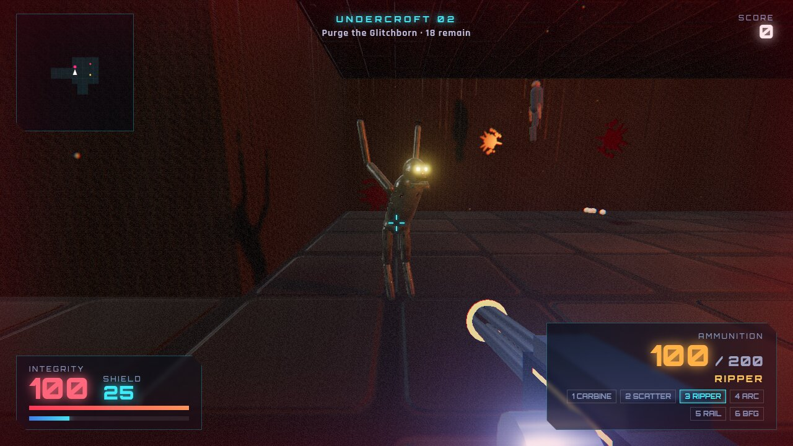
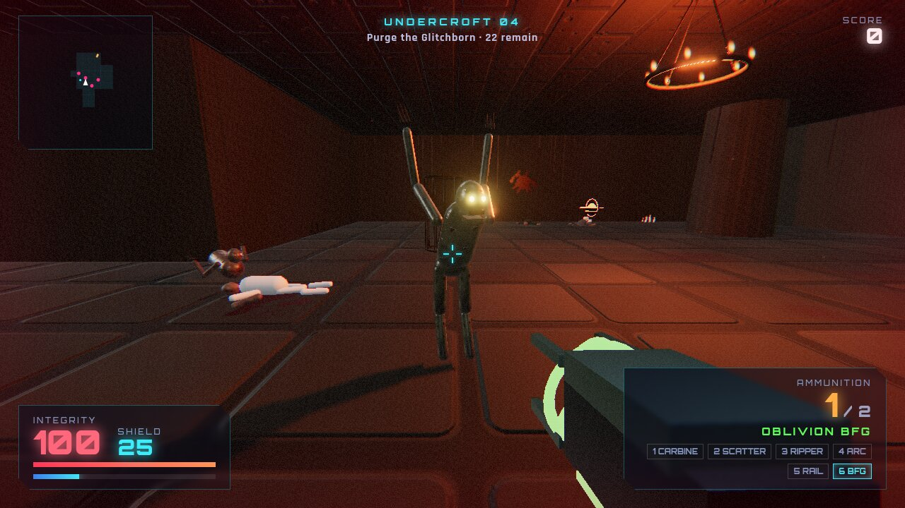
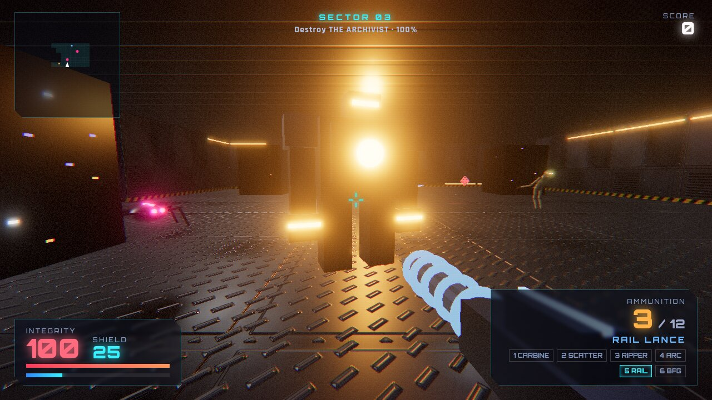

# NULL SECTOR

**A fast, horror-tinged first-person shooter that runs in your web browser.**

400 metres under Oxfordshire sits an abandoned data vault. Something woke up in it. Fight down through procedurally generated sectors: cold machine halls overrun by the Glitchborn, and beneath them the **Undercroft**, stone catacombs full of the dead and the things that eat them.

No installs, no downloads and no game engine. Everything is built in JavaScript with Three.js (WebGL): the textures, sounds and levels are all generated in code while the game runs.



| | |
|---|---|
|  |  |

---

## Contents
- [Quick start](#quick-start)
- [Full installation guide](#full-installation-guide)
  - [Windows](#windows) · [macOS](#macos) · [Linux](#linux)
  - [No Node.js? Other ways to run it](#no-nodejs-other-ways-to-run-it)
- [How to play](#how-to-play)
- [Controls](#controls)
- [Settings](#settings)
- [Weapons](#weapons)
- [Enemies](#enemies)
- [Tips](#tips)
- [Troubleshooting](#troubleshooting)
- [How it works](#how-it-works)
- [Project layout](#project-layout)
- [Credits and licence](#credits-and-licence)

---

## Quick start

You need **[Node.js](https://nodejs.org/) 18 or newer** and a modern browser (Chrome, Edge, Firefox or Safari).

```bash
git clone https://github.com/hosthobbit/null-sector.git
cd null-sector
npm start
```

Then open **http://localhost:8420** in your browser and click **ENTER THE VAULT**.

You don't need `npm install`. The game has no dependencies to download, because Three.js is already included in the `vendor/` folder.

---

## Full installation guide

### Step 1: Install Node.js

Node.js runs a tiny web server on your own computer so the browser can load the game. (Browsers block games like this if you just double-click `index.html`.)

1. Go to **https://nodejs.org/**.
2. Download the **LTS** version and install it with the default options.
3. Check it worked by opening a terminal (see the notes for your system below) and typing:
   ```bash
   node --version
   ```
   A version number such as `v22.x.x` should appear.

### Step 2: Download the game

**Option A: with Git** (recommended, easy to update later):
```bash
git clone https://github.com/hosthobbit/null-sector.git
```

**Option B: without Git:**
1. On the GitHub page, click the green **Code** button, then **Download ZIP**.
2. Unzip it anywhere, for example your Desktop. You'll get a folder called `null-sector-main`.

### Step 3: Start it

#### Windows
1. Open the game folder in File Explorer.
2. Click the address bar, type `cmd` and press **Enter**. A Command Prompt opens in that folder.
3. Type:
   ```
   node server.js
   ```
4. Leave that window open. Open your browser and go to **http://localhost:8420**.

#### macOS
1. Open **Terminal** (Cmd+Space, type *Terminal*).
2. Type `cd `, with a space after it, then drag the game folder onto the Terminal window and press **Enter**.
3. Type:
   ```bash
   node server.js
   ```
4. Open **http://localhost:8420** in Safari or Chrome.

#### Linux
```bash
cd null-sector
./play.sh
```
`play.sh` starts the server if it isn't already running and opens the game in your default browser. You can also run `node server.js` and open http://localhost:8420 yourself.

*Optional desktop launcher* (so it shows up in your applications menu):
```bash
cat > ~/.local/share/applications/null-sector.desktop <<EOF
[Desktop Entry]
Name=NULL SECTOR
Comment=First-person horror shooter
Exec=$PWD/play.sh
Terminal=false
Type=Application
Categories=Game;
EOF
```

### Step 4: Play
Click **ENTER THE VAULT**. The game captures your mouse; press **Esc** to get it back.

To stop the server afterwards, go back to the terminal and press **Ctrl+C**.

### Using a different port
If port 8420 is already in use:
```bash
node server.js 9000
```
Then open http://localhost:9000.

### No Node.js? Other ways to run it
The game is just static files, so any local web server works. From inside the game folder:

| You have | Command | Then open |
|---|---|---|
| Python 3 | `python3 -m http.server 8420` (Windows: `py -m http.server 8420`) | http://localhost:8420 |
| PHP | `php -S localhost:8420` | http://localhost:8420 |
| VS Code | Install the **Live Server** extension, right-click `index.html`, then **Open with Live Server** | (opens itself) |

You can also upload the whole folder to any web host, or turn on **GitHub Pages** for a fork (Settings, then Pages, then *Deploy from branch*, `main`, `/ (root)`). It works from any sub-folder.

---

## How to play

- **Goal:** each sector is sealed. **Kill every enemy** to open the **exit portal**, then walk into it to descend.
- **Sectors are generated fresh every run**, and every one is bigger and nastier than the last.
- **Two worlds alternate as you go down:**
  - **The Vault** (sector 1, then odd sectors): steel halls, hazard stripes, server racks and the machine Glitchborn.
  - **The Undercroft** (sector 2, then even sectors): stone catacombs lit by torches and chandeliers, with corpses, hanging bodies, cages, skull piles, candles and blood-scrawled walls, plus the flesh monsters.
- **Bosses:** every 3rd sector is guarded by a boss (**THE ARCHIVIST** in the Vault, **THE HOLLOW KING** in the Undercroft).
- **Pickups** are glowing, spinning crystals: **red** for health (+25), **cyan** for shield (+35), **orange** for ammo. Weapon pickups announce themselves when you grab them. Green **OBLIVION cells** (BFG ammo) are rare.
- **Score:** chain kills within 3 seconds to build a **combo multiplier up to x6**. Getting hit resets it. Clearing a sector quickly earns a time bonus. Your **best score is saved** in your browser.
- **Death:** when your Integrity hits 0 the run ends. Start again and the sectors are all new.

The **minimap** (top left) shows the layout around you (you're the white arrow), enemies and pickups.

---

## Controls

| Key | Action |
|---|---|
| **W A S D** | Move |
| **Mouse** | Look |
| **Left click** | Fire (hold for automatic weapons, hold to charge the BFG) |
| **Shift** | Sprint |
| **Space** | Jump |
| **Q** | Phase dash: short burst of speed with brief invulnerability |
| **R** | Reload |
| **1 – 6** or **mouse wheel** | Change weapon |
| **F** | Show or hide the FPS counter |
| **Esc** | Pause menu: Resume, Settings, Abandon run |

---

## Settings

Press **Esc**, then **SETTINGS** (also on the title screen). Changes apply straight away and are remembered. **RESET TO DEFAULTS** puts everything back.

| Setting | What it does |
|---|---|
| **Mouse sensitivity** | How fast the view turns (0.05–2, default 0.5). Lower it if aiming feels twitchy. |
| **Invert Y** | Flip vertical look |
| **Field of view** | 60–110°. A wider FOV shows more but makes enemies look smaller. |
| **Volume** | Master volume for music and effects |
| **Graphics quality** | **High**: shadows, bloom and full resolution. **Medium / Low** for older laptops. |
| **Show FPS** | Frame-rate counter |
| **Blood & gore** | Turns off blood, gibs and gore decorations |

The game also lowers its resolution by itself if the frame rate drops.

---

## Weapons

| # | Weapon | Found | What it's for |
|---|---|---|---|
| 1 | **Pulse Carbine** | Start | Reliable automatic rifle. Hold to fire. |
| 2 | **Scatter Cannon** | Sector 1 | Close-range shotgun blast. Devastating up close. |
| 3 | **Ripper** | Sector 2 | Minigun. Spins up, then shreds everything in front of you. |
| 4 | **Arc Launcher** | Sector 2 | Explosive energy grenades with splash damage. Good for groups. |
| 5 | **Rail Lance** | Sector 3 | Pierces **every** enemy in a straight line. Line them up. |
| 6 | **OBLIVION BFG** | Sector 2 | **Hold to charge, release to fire.** One shot kills **everything** within 60 m that can see the blast or you, and everything within 12 m even through walls. Very little ammo; save it for a boss or an emergency. |

Each new weapon appears as a glowing pickup somewhere in the sector where it unlocks. Once you have a weapon, you keep it for the rest of the run.

---

## Enemies

### Machines (the Vault)
| Enemy | Behaviour |
|---|---|
| **Skitter** | Small, fast, comes in swarms. Weak on its own. |
| **Sentinel** | Keeps its distance and fires energy bolts. |
| **Colossus** | Big and slow, soaks up damage and hits very hard. |
| **THE ARCHIVIST** (boss) | Fires volleys of bolts and summons Skitters. |

### Monsters (the Undercroft)
| Enemy | Behaviour |
|---|---|
| **Ghoul** | Sprints at you and lunges. Usually in packs. |
| **Crawler** | Drags itself along the floor. Low and easy to miss, so look down. |
| **Butcher** | Horned brute. Charges and slams. Sidestep the charge. |
| **Wraith** | Floats above the ground and lobs arcing acid. |
| **THE HOLLOW KING** (boss) | Towering, and keeps raising Ghouls. Kill the adds or save the BFG for him. |

Monsters bleed, leave corpses where they fall, and burst into gibs from explosions and big hits.

---

## Tips
- **Keep moving.** Strafing (A/D) dodges most projectiles.
- **Q (phase dash)** makes you briefly invulnerable, so dash *through* a Butcher's charge or an acid volley.
- **Line enemies up for the Rail Lance** in corridors.
- **Use the Arc Launcher and Scatter on packs of Ghouls and Skitters.**
- **Don't get hit** if you're chasing a high score: the x6 combo is worth more than anything else.
- **Save the BFG.** Charge it before you round the corner into the boss room.

---

## Troubleshooting

| Problem | Fix |
|---|---|
| **Black screen or "Failed to load module"** when opening `index.html` directly | Browsers block modules from `file://` pages. Start the server (`node server.js`) and use **http://localhost:8420**. |
| **`node` is not recognised** | Node.js isn't installed or the terminal was open before you installed it. Install from nodejs.org, then open a **new** terminal. |
| **"EADDRINUSE" / port already in use** | The game is already running (just open the address) or something else uses the port. Try `node server.js 9000`. |
| **Low frame rate** | Esc, then Settings, then Graphics quality **Medium** or **Low**. Close other heavy tabs. On laptops, plug in the charger and make sure the browser uses the dedicated GPU. |
| **Mouse turns too fast or too slow** | Esc, then Settings, then **Mouse sensitivity**. |
| **Mouse won't lock or the view won't turn** | Click inside the game window. Some browsers need one click after Esc before they'll lock the mouse again. |
| **No sound** | Browsers only allow audio after you click. Click **ENTER THE VAULT**, check the Volume setting and that the tab isn't muted. |
| **Music keeps playing in the background** | The game pauses its audio when the tab is hidden or closed. If you still hear it, another copy is open in some other browser window; close that. |
| **"WebGL not supported"** | Update your browser and graphics drivers. In Chrome, check `chrome://gpu` shows WebGL as *Hardware accelerated*. |
| **Blood too much?** | Esc, then Settings, then turn off **Blood & gore**. |
| **Reset settings and best score** | Open the browser console (F12) on the game page and run `localStorage.clear()`. |

---

## How it works

For the curious:

- **Rendering:** [Three.js](https://threejs.org/) r186 (WebGL 2) with physically based materials, image-based lighting (RoomEnvironment PMREM), real-time shadows and ACES filmic tone mapping.
- **Post-processing:** an EffectComposer chain (scene pass, separate weapon view-model pass so the gun never clips into walls, Unreal bloom, then a custom final shader for chromatic aberration, vignette, film grain and damage flashes).
- **Procedural everything:** textures (colour, normal and roughness maps for metal, stone, flagstone and skin), sound (Web Audio synthesis for all effects and music), and levels (grid-based room-and-corridor generator, with decoration passes for the Undercroft).
- **AI:** a breadth-first flow field from the player lets every enemy find a path through the level cheaply. Each enemy type has its own attack behaviour.
- **Performance:** adaptive resolution scaling, and caps on corpses, decals and particles.
- **No build step:** plain ES modules loaded through an import map. Edit a file, refresh the browser.

## Project layout

```
null-sector/
├── index.html        HUD, menus, settings panel, import map
├── server.js         Tiny zero-dependency static web server (port 8420)
├── play.sh           Linux/macOS launcher: starts server + opens browser
├── package.json      `npm start` shortcut
├── src/
│   ├── main.js       Game loop, weapons firing, BFG, scoring, sectors, settings
│   ├── level.js      Procedural level generator, themes, lighting
│   ├── horror.js     Undercroft decoration: bodies, cages, chains, candles, writing
│   ├── enemies.js    Enemy models, AI and animations
│   ├── weapons.js    Weapon stats and first-person view-models
│   ├── projectiles.js  Bolts, grenades, acid, BFG orb
│   ├── pickups.js    Health, shield, ammo, weapon pickups
│   ├── effects.js    Particles, blood, gibs, decals
│   ├── textures.js   Procedural texture generation
│   ├── audio.js      Synthesised sound effects and music
│   ├── player.js     Movement, jumping, dash
│   └── physics.js    Collision against the level grid
├── vendor/three/     Three.js r186 (only the files the game uses, MIT licence)
└── docs/             Screenshots for this README
```

## Credits and licence

Made by **[Host Hobbit Ltd](https://hosthobbit.com)**.

- Game code: **MIT licence**, see [LICENSE](LICENSE). Fork it, mod it or learn from it.
- Three.js © three.js authors, MIT licence (see `vendor/three/LICENSE`).
